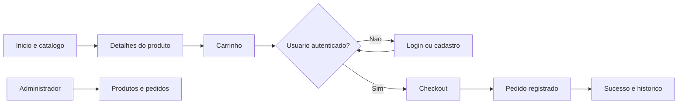

# Loja Esportes - Documentacao do Projeto

## Apresentacao

Este documento apresenta o projeto **Loja Esportes**, uma aplicacao web de comercio eletronico desenvolvida para a venda de produtos esportivos. O sistema permite consultar um catalogo, visualizar detalhes dos produtos, selecionar cor e tamanho, adicionar itens ao carrinho, realizar cadastro e login, finalizar pedidos e acompanhar compras. Tambem existe uma area administrativa para gerenciamento de produtos e pedidos.

O projeto foi desenvolvido como uma atividade interdisciplinar, relacionando conhecimentos de programacao web, banco de dados, experiencia do usuario e conceitos de matematica aplicados ao comercio. O objetivo e demonstrar como uma necessidade cotidiana, como comprar produtos esportivos pela internet, pode ser modelada e resolvida por meio de um sistema computacional.

## 1. Introducao

### 1.1 Contextualizacao

O comercio eletronico transformou a maneira como as pessoas pesquisam e compram produtos. Em uma loja virtual, informacoes como preco, estoque, categoria, marca, formas de pagamento e endereco de entrega precisam ser organizadas e processadas de forma consistente.

A disciplina de Matematica pode ser relacionada ao projeto por meio dos calculos de preco unitario, quantidade, subtotal, total da compra, parcelamento e regra de frete gratis. A disciplina de Informatica, por sua vez, contribui com a logica de programacao, a construcao de paginas web, o armazenamento de dados e a comunicacao entre o usuario e o sistema.

### 1.2 Problema

Uma loja que depende apenas de atendimento presencial possui limitacoes de horario, alcance geografico e organizacao dos produtos. Alem disso, controlar manualmente estoque, carrinho, clientes e pedidos pode causar erros de registro e dificultar o acompanhamento das compras.

O problema abordado pelo projeto e a necessidade de oferecer uma plataforma simples para que clientes encontrem produtos esportivos, escolham suas variacoes, montem um carrinho e registrem um pedido, enquanto a administracao consegue consultar e organizar os dados da loja.

### 1.3 Justificativa

O desenvolvimento de um software para esse problema e importante porque centraliza informacoes e automatiza etapas que seriam feitas manualmente. O sistema apresenta os produtos de maneira padronizada, calcula os valores da compra, guarda os pedidos no banco de dados e reduz a repeticao de tarefas.

A aplicacao tambem e adequada para fins educacionais, pois permite praticar conceitos de HTML, CSS, JavaScript, PHP, MySQL, sessoes, formularios, validacao de dados e relacionamento entre tabelas.

### 1.4 Objetivos

#### Objetivo geral

Desenvolver uma aplicacao web de loja esportiva que permita consultar produtos, gerenciar um carrinho de compras, realizar pedidos e apoiar a administracao do catalogo.

#### Objetivos especificos

1. Criar um catalogo com produtos, categorias, marcas, precos, imagens, estoque, cores e tamanhos.
2. Desenvolver paginas de listagem, busca, categorias e detalhes de cada produto.
3. Permitir cadastro, login e controle de acesso ao checkout.
4. Implementar um carrinho com adicao, remocao, alteracao de quantidade e calculo de subtotal.
5. Calcular o total do pedido e aplicar frete gratis para compras de qualquer valor.
6. Registrar pedidos e seus itens no banco de dados.
7. Disponibilizar opcoes de pagamento por cartao de credito, cartao de debito e PIX.
8. Criar uma area administrativa para produtos e pedidos.
9. Aplicar conhecimentos de programacao, banco de dados e organizacao de interfaces em um sistema funcional.

## 2. Referencial teorico

### 2.1 Fundamentacao da disciplina parceira

#### Matematica aplicada ao comercio

No comercio, o preco de uma compra depende da quantidade de produtos e do preco unitario de cada item. O subtotal de um item pode ser representado por:

`subtotal = preco unitario x quantidade`

O total dos produtos e obtido pela soma dos subtotais:

`total = subtotal_1 + subtotal_2 + ... + subtotal_n`

No projeto, o frete e gratuito para qualquer compra. Essa regra pode ser expressa por:

`frete = R$ 0,00, para qualquer total de compra`

Na pagina de produto tambem e exibida uma simulacao de parcelamento em seis vezes sem juros. Para uma parcela simples, o calculo e:

`parcela = preco / 6`

Esses calculos mostram como operacoes matematicas sao transformadas em regras de negocio executadas pelo programa. O sistema tambem organiza dados de estoque, tamanhos e cores, que representam variaveis importantes para a venda de produtos esportivos.

#### Organizacao de uma loja virtual

Uma loja virtual precisa separar o catalogo, os usuarios, os pedidos e os itens de cada pedido. Essa separacao evita que todas as informacoes fiquem misturadas e facilita consultas, atualizacoes e relatorios.

O projeto utiliza entidades com funcoes diferentes: produtos representam o catalogo; usuarios representam clientes; pedidos representam compras; itens_pedido representam os produtos presentes em cada compra; e admin_users representam os administradores.

### 2.2 Fundamentacao tecnologica

#### HTML e CSS

HTML e utilizado para estruturar as paginas, formularios, botoes, imagens e textos. CSS e utilizado para definir cores, espacamentos, tipografia, responsividade, cards de produtos e estados visuais da interface.

#### JavaScript

JavaScript executa comportamentos no navegador, como selecao de cor e tamanho, validacoes da interface, notificacoes, animacoes, atualizacao do carrinho e busca de informacoes de CEP.

#### PHP

PHP e a linguagem executada no servidor. Ela recebe dados dos formularios, inicia sessoes, consulta o MySQL, calcula valores, registra pedidos e monta paginas HTML dinamicas. O projeto segue um estilo procedural, com paginas PHP que combinam processamento e apresentacao.

#### MySQL/MariaDB

O banco de dados armazena as informacoes de forma persistente. O esquema do projeto possui tabelas para administradores, usuarios, produtos, pedidos e itens de pedido. As chaves primarias identificam os registros e as chaves estrangeiras relacionam pedidos aos usuarios e aos produtos.

#### Bibliotecas e servicos utilizados

O projeto utiliza Bootstrap para auxiliar na estrutura responsiva, Font Awesome para icones, AOS para animacoes de entrada e fontes do Google Fonts. Tambem existem integracoes auxiliares para consulta de CEP, calculo de frete e geracao de QR Code PIX.

## 3. Metodologia

### 3.1 Tecnologias utilizadas

| Tecnologia | Uso no projeto | Motivo da escolha |
| --- | --- | --- |
| HTML5 | Estrutura das paginas | Padrao para organizar o conteudo web |
| CSS3 | Estilo e responsividade | Permite criar uma interface visual e adaptavel |
| JavaScript | Interacoes no navegador | Melhora a experiencia sem recarregar todas as paginas |
| PHP 8 | Regras do servidor | Integra formularios, sessoes e banco de dados |
| MySQL/MariaDB | Persistencia dos dados | Armazena produtos, usuarios e pedidos |
| Bootstrap 5 | Componentes e grid | Acelera a criacao de layouts responsivos |
| Font Awesome | Icones | Reforca a identificacao visual das acoes |
| XAMPP | Ambiente local | Fornece Apache, PHP e MySQL/MariaDB para testes |
| VS Code | Edicao do codigo | Facilita organizacao e manutencao dos arquivos |

### 3.2 Arquitetura e design do projeto

O sistema foi organizado em paginas PHP com responsabilidades especificas. O arquivo `header.php` concentra a sessao, a conexao com o banco e a navegacao comum. O arquivo `conexao.php` estabelece a comunicacao com o MySQL/MariaDB e disponibiliza funcoes auxiliares.

O fluxo principal pode ser resumido assim:

Os arquivos foram agrupados por responsabilidade sem alterar as URLs publicas existentes:

- `cliente/`: implementacao das paginas e acoes da loja. Os arquivos PHP publicos na raiz encaminham as requisicoes para esta pasta.
- `admin/`: implementacao das paginas e acoes administrativas. Os arquivos `admin_*.php` na raiz encaminham as requisicoes para esta pasta.
- `api/`: implementacao das APIs de CEP, frete, sugestoes de busca e PIX. Os endpoints originais continuam disponiveis na raiz.
- `scripts/`: rotinas administrativas de importacao de produtos e atualizacao de imagens.
- `tests/`: pagina auxiliar para testar as APIs.
- `db/`, `css/`, `uploads/` e `cache/`: banco de dados, estilos, imagens enviadas e cache.
- Os componentes PHP compartilhados permanecem na raiz; os encaminhadores preservam os links e formularios atuais.

As principais paginas e responsabilidades sao:

- `index.php`: pagina inicial e produtos em destaque.
- `produtos.php`, `categoria.php` e `busca.php`: navegacao e filtragem do catalogo.
- `produto.php`: detalhes, selecao de cor e tamanho e acao de compra.
- `carrinho.php`: itens, quantidades, subtotal, total e frete.
- `login.php` e `cadastro.php`: autenticacao e criacao de contas.
- `checkout.php`: dados de entrega, pagamento e criacao do pedido.
- `pedido_sucesso.php`, `meus_pedidos.php` e `pedido_detalhes.php`: confirmacao e consulta de pedidos.
- `admin.php`, `admin_produtos.php` e `admin_pedidos.php`: acesso administrativo.

### 3.3 Interdisciplinaridade na pratica

O conceito matematico foi traduzido para o codigo por meio de variaveis numericas e operacoes realizadas no carrinho e no checkout. Para cada produto, o sistema recupera o preco no banco, multiplica pela quantidade e soma os resultados. A regra de frete e aplicada comparando o total com o limite definido pela loja.

Na pagina de produto, o valor dividido por seis apresenta uma referencia de parcelamento. No checkout, o sistema valida a forma de pagamento escolhida, monta o endereco completo, cria o registro do pedido e grava cada produto na tabela `itens_pedido`.

O uso do banco de dados tambem representa uma aplicacao pratica de organizacao de informacoes: um usuario pode possuir varios pedidos, e um pedido pode possuir varios itens. Esse relacionamento permite recuperar o historico de compras sem duplicar todas as informacoes do cliente em cada tela.

## 4. Desenvolvimento e resultados

### 4.1 O software em funcionamento

O produto final apresenta as seguintes funcionalidades:

1. **Pagina inicial:** mostra a identidade da loja, categorias, produtos em destaque, precos e disponibilidade.
2. **Catalogo e busca:** permite localizar produtos por categoria, nome ou outros filtros disponiveis.
3. **Detalhes do produto:** exibe imagem, marca, descricao, preco, estoque, cores e tamanhos.
4. **Carrinho:** agrupa os itens selecionados, mostra variacoes escolhidas, permite alterar quantidades e remover produtos.
5. **Cadastro e login:** identifica o cliente antes da finalizacao do pedido.
6. **Checkout:** coleta telefone e endereco, valida a forma de pagamento e cria o pedido.
7. **Pagamento:** oferece cartao de credito, cartao de debito e PIX, com geracao de QR Code para PIX.
8. **Historico de pedidos:** permite consultar pedidos realizados e seus detalhes.
9. **Administracao:** permite gerenciar produtos e visualizar pedidos.

### 4.2 Capturas de tela

Para a versao final do trabalho, devem ser inseridas capturas do sistema em funcionamento. Sugestao de figuras:

- **Figura 1 - Pagina inicial e produtos em destaque:** abrir `http://localhost/loja_esportes/`.
- **Figura 2 - Tela de detalhes do produto:** selecionar um produto no catalogo.
- **Figura 3 - Carrinho de compras:** adicionar um produto e abrir o carrinho.
- **Figura 4 - Checkout:** acessar o checkout com usuario autenticado.
- **Figura 5 - Confirmacao do pedido:** finalizar uma compra de teste.
- **Figura 6 - Area administrativa:** abrir a tela de produtos ou pedidos como administrador.

As imagens devem mostrar o sistema rodando no navegador, com uma legenda explicando qual funcionalidade esta sendo demonstrada.

### 4.3 Testes realizados e resultados esperados

| Teste | Procedimento | Resultado esperado |
| --- | --- | --- |
| Catalogo | Abrir a pagina inicial | Produtos em destaque aparecem com nome, preco e estoque |
| Detalhes | Abrir um produto | Dados, imagem, cores e tamanhos sao apresentados |
| Selecao | Tentar comprar sem escolher cor ou tamanho | O sistema solicita o preenchimento das variacoes |
| Carrinho | Adicionar, aumentar, reduzir e remover item | Quantidades e totais sao atualizados corretamente |
| Frete | Montar carrinho com qualquer valor | O sistema apresenta frete gratis e valor R$ 0,00 |
| Cadastro/login | Criar conta e autenticar | Usuario e direcionado para a area da loja |
| Checkout | Preencher endereco e escolher pagamento | Pedido e gravado e a pagina de sucesso e exibida |
| Historico | Consultar pedidos depois da compra | Pedido aparece associado ao usuario logado |
| Administracao | Acessar area administrativa | Administrador consegue consultar produtos e pedidos |
| CEP e PIX | Consultar CEP e escolher PIX | Dados de endereco e QR Code sao processados quando os servicos estao disponiveis |

Os testes devem ser executados com Apache e MySQL/MariaDB ativos no XAMPP. A validacao dos calculos pode ser feita comparando manualmente o preco unitario multiplicado pela quantidade com o subtotal exibido e somando os subtotais para conferir o total.

### 4.4 Analise dos resultados

O projeto atende ao objetivo principal de representar o fluxo basico de uma loja virtual. Ele resolve a necessidade de organizar um catalogo, permitir a montagem de uma compra e registrar pedidos em um banco de dados. A interface tambem torna visiveis os conceitos matematicos usados no comercio, especialmente quantidade, preco, subtotal, total, parcelamento e limite de frete gratis.

Como resultado educacional, o sistema demonstra que uma regra teorica pode ser transformada em uma funcao ou em uma sequencia de instrucoes de programa. O usuario fornece dados, o sistema processa esses dados e a interface apresenta uma resposta compreensivel.

## 5. Consideracoes finais

O objetivo geral foi alcancado com a construcao de uma loja esportiva web que integra catalogo, autenticacao, carrinho, checkout, pedidos e administracao. O trabalho permitiu aplicar conhecimentos de desenvolvimento front-end, programacao no servidor, banco de dados e matematica aplicada a uma situacao pratica.

Entre os principais desafios tecnicos estiveram a integracao entre paginas PHP, sessoes do carrinho, associacao de cores e tamanhos, persistencia dos pedidos e comunicacao com servicos auxiliares. Entre os desafios conceituais estiveram a definicao das regras de preco, a organizacao do fluxo de compra e a traducao dos calculos para instrucoes que o computador pudesse executar.

O projeto ainda possui limitacoes. A aplicacao depende do ambiente XAMPP e da configuracao local do banco; algumas imagens e servicos sao externos; o sistema nao deve ser considerado uma plataforma de producao sem uma revisao de seguranca; e ainda podem ser aprimorados o controle de estoque durante a compra, a validacao de dados, a seguranca das senhas de usuarios e o tratamento transacional de pedidos.

Como trabalhos futuros, podem ser adicionados:

- pagamento real por um gateway homologado;
- atualizacao automatica do estoque apos a confirmacao do pedido;
- envio de e-mails em ambiente de producao;
- recuperacao de senha e verificacao de e-mail;
- filtros avancados e avaliacao dos produtos;
- relatorios de vendas para a administracao;
- uso de consultas preparadas e politicas mais completas de seguranca;
- testes automatizados e publicacao em um servidor online;
- calculo de frete por transportadora e acompanhamento da entrega.

## Referencias do proprio projeto

- Arquivo SQL em `db/loja_esportes(13).sql`.
- Conexao e funcoes de banco em `conexao.php`.
- Regras do checkout em `checkout.php`.
- Interacoes do catalogo e do carrinho em `script.js` e nos arquivos PHP correspondentes.
- Estilos principais em `css/style.css` e estilos complementares em `header.php`.
